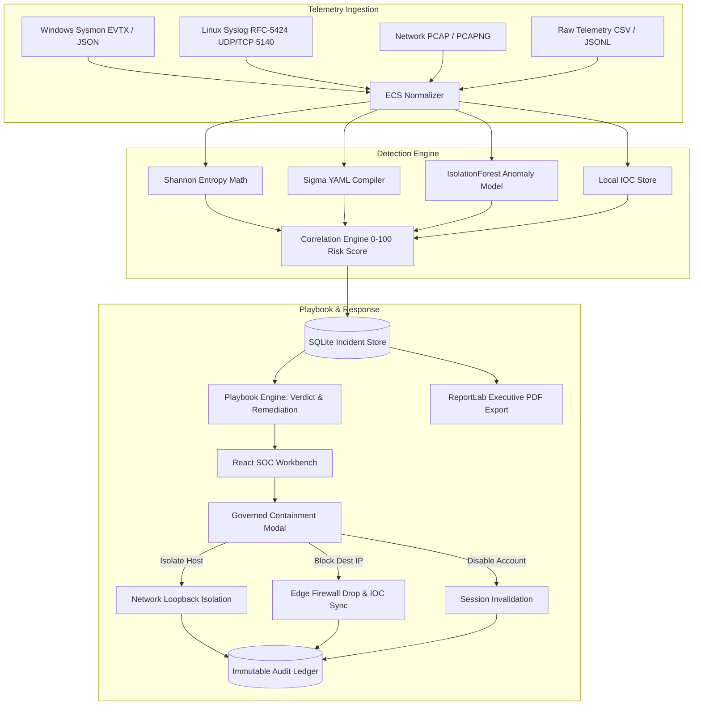

# NetraShield SOC

**An offline-capable Blue Team threat triage, telemetry correlation, and governed incident response workbench.**

NetraShield SOC ingests raw security telemetry, normalizes events into Elastic Common Schema (ECS), detects obfuscated strings using Shannon entropy, correlates threats with Sigma YAML rules, an `IsolationForest` anomaly model, and local IOCs, and executes confirmation-gated containment actions backed by an immutable SQLite audit ledger.

> **Execution Safety:** Containment and SOAR actions run in **safe simulated mode** by default for local demonstrations and testing, recording every action, status transition, and rollback in an immutable SQLite audit ledger.

---

## Quick Start

### Local Setup

**Prerequisites:** Python 3.10+ and Node.js 18+ with npm.

#### 1. Backend Installation
```bash
python -m venv .venv

# On Linux/macOS:
source .venv/bin/activate

# On Windows (PowerShell):
.\.venv\Scripts\Activate.ps1

pip install -r requirements.txt
```

#### 2. Frontend Installation & Build
```bash
cd frontend
npm ci
npm run build
cd ..
```

#### 3. Running NetraShield
```bash
# Terminal 1: Backend API & Syslog listener (UDP/TCP 5140)
uvicorn backend.main:app --host 127.0.0.1 --port 8000

# Terminal 2: Frontend Vite dev server (Optional for development)
cd frontend
npm run dev -- --host 127.0.0.1 --port 5173
```

Access the application at `http://127.0.0.1:8000` (production single-service) or `http://127.0.0.1:5173` (Vite dev server).

### Docker Deployment

Build and run using the multi-stage Docker container:

```bash
docker build -t netrashield-soc .
docker run -d -p 8000:8000 -p 5140:5140/udp -p 5140:5140/tcp --name netrashield netrashield-soc
```

Open `http://localhost:8000` in your browser.

---

## Screenshots

> Add 1–2 screenshots (such as the main triage workbench, Sigma Rule Studio, or Process Lineage Graph) to a `docs/` folder and link them below:
> - ``
> - ``

---

## Architecture Overview



### Core Components
* **ECS Normalizer Engine (`backend/netrashield/parser.py`):** Converts Windows Sysmon (`.evtx`, JSON), Syslog (RFC-5424), PCAP, and CSV records into standard ECS structures.
* **Shannon Entropy Math (`backend/netrashield/parser.py`):** Computes byte-level entropy ($H(X) = -\sum p_i \log_2 p_i$) across command-line strings to flag packed, XORed, or Base64-encoded payloads.
* **Correlation Engine (`backend/netrashield/core_engine.py`):** Combines deterministic Sigma rules (`rules/sigma/`), an Isolation Forest anomaly detector, and a local IOC hash/IP/domain lookup table (`intel/ioc_store.json`).
* **Playbook & Containment Subsystem (`backend/netrashield/playbook.py`):** Produces plain-English root-cause verdicts, contextual 4-step MITRE remediation checklists, and executes governed containment actions (`ISOLATE_HOST`, `BLOCK_DEST_IP`, `DISABLE_USER_ACCOUNT`).
* **Audit Ledger (`backend/netrashield/database.py`):** Records all triage actions, status transitions, and analyst notes into an immutable SQLite ledger using parameterized queries.
* **Sigma Rule Studio (`frontend/src/components/SigmaStudioView.tsx`):** Monospace YAML editor supporting live syntax validation, drafting, saving, and hot-reloading Sigma rules directly in the browser.
* **Process Lineage Visualizer (`frontend/src/components/ProcessTreeGraph.tsx`):** Visual trace linking host endpoints, parent processes, executed commands, and destination C2 addresses.

---

## Sample Triage Workflow

1. **Ingest:** Send Sysmon (`.evtx`, JSON), RFC-5424 Syslog (UDP/TCP `5140`), PCAP/PCAPNG, or CSV/JSONL telemetry via `POST /api/triage/run`.
2. **Correlate:** NetraShield normalizes fields into ECS, calculates command-line entropy, evaluates Sigma YAML rules and local IOCs, and scores behavioral anomalies with `IsolationForest` on a `0–100` scale.
3. **Investigate:** Inspect the process lineage tree, review the automated root-cause verdict and MITRE remediation checklist, and update incident status (`Open`, `Investigating`, `Escalated`, `Contained`, `Resolved`, `Closed`).
4. **Contain & Report:** Confirm and execute a containment or SOAR action, verify the immutable audit entry via `/api/audit`, and export reports as DDE-sanitized CSV, JSON, or ReportLab PDF.

---

## API Endpoints

### Threat Ingestion & Correlation
* `GET /api/health` - Subsystem health matrix (ECS parser, Sigma compiler, ML model, SQLite store, Syslog socket).
* `POST /api/triage/run` - Upload telemetry file (`.json`, `.csv`, `.evtx`, `.pcap`, `.log`) or trigger synthetic correlation.
* `GET /api/triage/export/{format}` - Export incidents as CSV (with DDE formula sanitization), JSON, or PDF.
* `PATCH /api/incidents/{alert_id}` - Update incident status (`Open`, `Investigating`, `Escalated`, `Contained`, `Resolved`, `Closed`).

### Playbook & Governed Containment
* `GET /api/incidents/{alert_id}/verdict` - Generates automated plain-English analysis and MITRE remediation steps.
* `POST /api/incidents/{alert_id}/contain` - Executes governed containment (`ISOLATE_HOST`, `BLOCK_DEST_IP`, `DISABLE_USER_ACCOUNT`). Requires `confirmed: true`.
* `GET /api/incidents/{alert_id}/audit` - Retrieves audit history for an incident.
* `GET /api/audit` - Retrieves global containment audit ledger.

### Sigma Rule Management
* `GET /api/rules` - Enumerates active Sigma rules.
* `POST /api/rules` - Validates YAML structure, saves to `rules/sigma/`, and hot-reloads the engine.
* `DELETE /api/rules/{rule_id}` - Removes a Sigma rule file and reloads the engine.

### Threat Intelligence & SOAR
* `GET /api/iocs` & `POST /api/iocs` - Manage IP, domain, and SHA256 indicators.
* `GET /api/soar/playbooks` & `POST /api/soar/execute` - Automated SOAR playbooks with rollback support (`/api/soar/rollback`).
* `WS /ws/syslog` - WebSocket feed streaming raw Syslog events ingested on port 5140.

---

## Security Controls & Automated Test Suite

NetraShield enforces strict file extension allowlists, parameterized SQLite queries, DDE formula-injection sanitization on CSV exports, and hardened HTTP security headers (`nosniff`, `DENY`, CSP).

Run the full security and correlation test suite:

```bash
python -m unittest discover -s tests -v
```

The test suite validates:
* Multi-format ECS normalization (Sysmon, Syslog, PCAP, CSV).
* Shannon entropy math on benign vs. obfuscated payloads.
* Isolation Forest anomaly detection and thresholding.
* Sigma rule compilation and IOC correlation.
* Playbook verdict generation and MITRE checklist mapping.
* Governed containment execution and immutable SQLite audit logging.
* DDE formula injection sanitization on CSV exports.
* ReportLab executive PDF generation.
* Strict file extension allowlists and HTTP security headers (`nosniff`, `DENY`, CSP).

---

## License

MIT License
